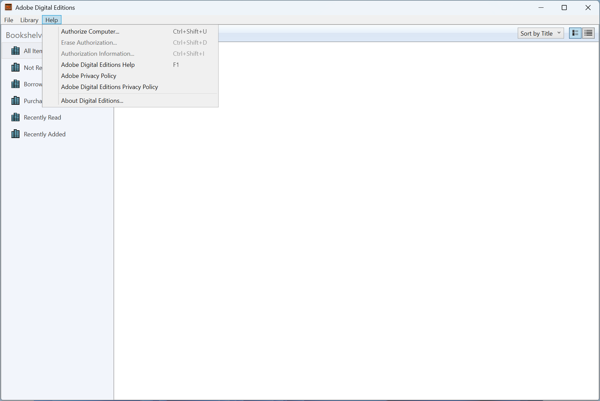
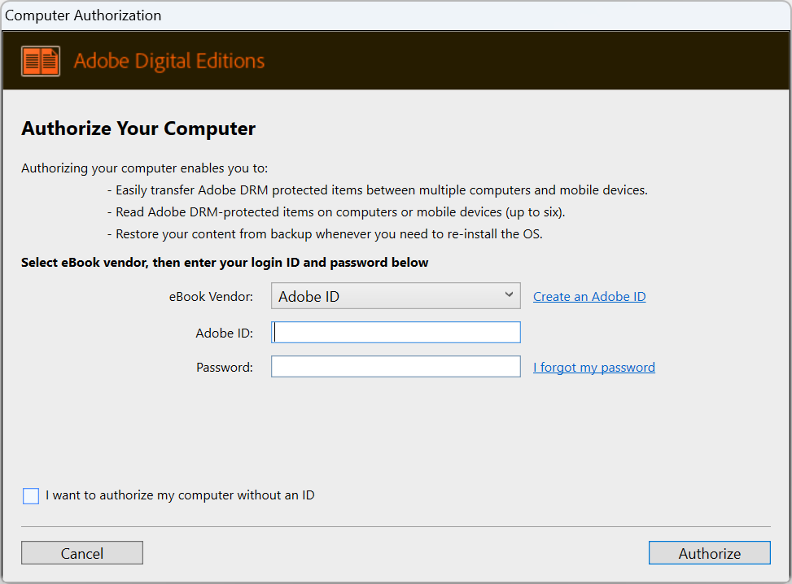
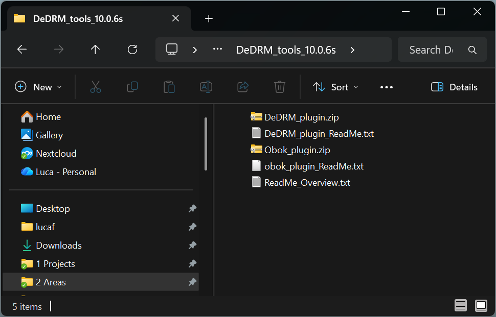
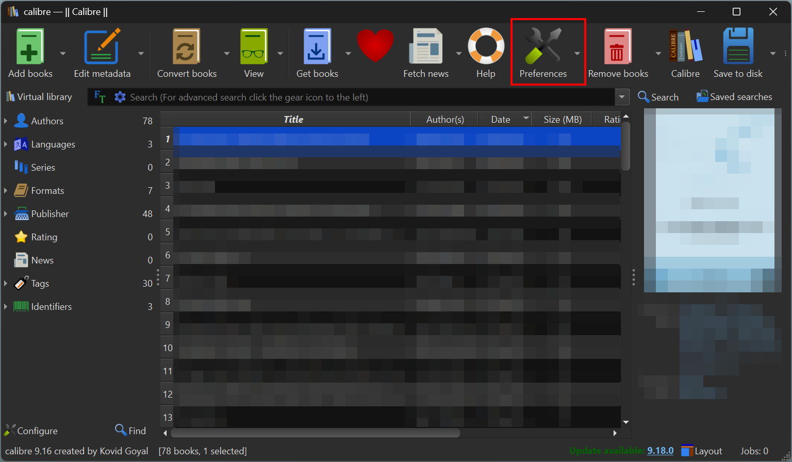
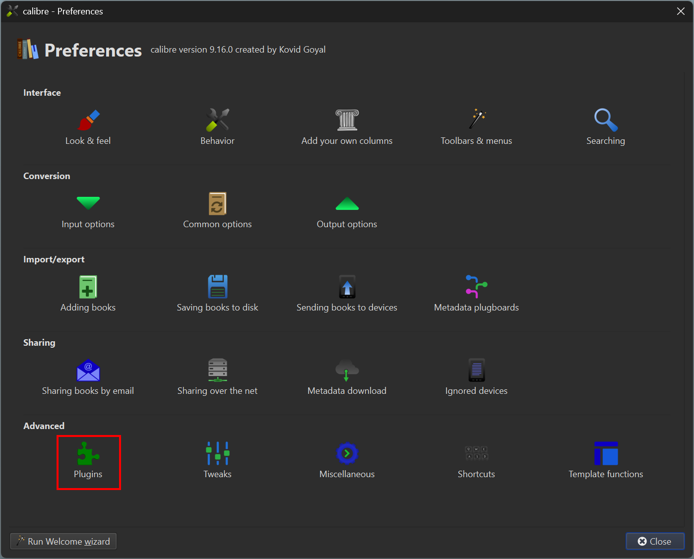
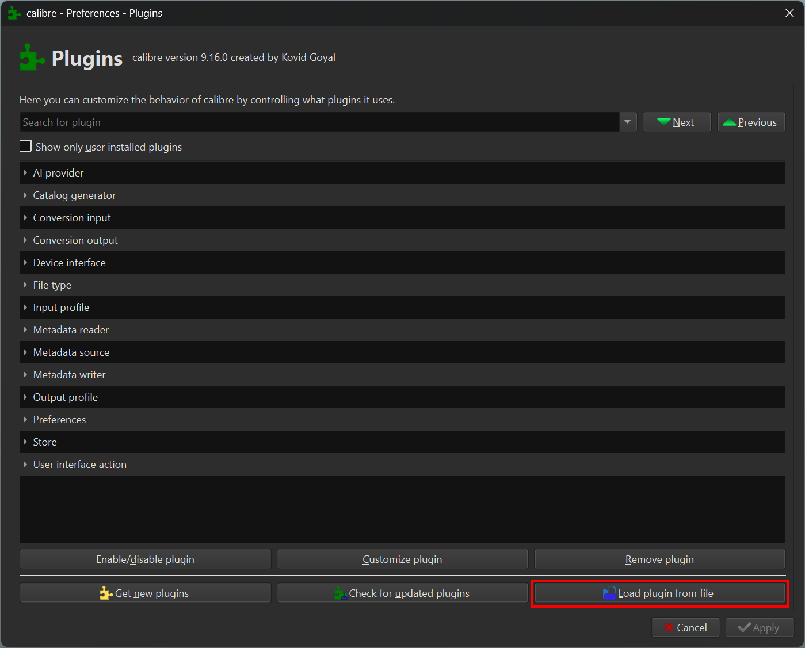
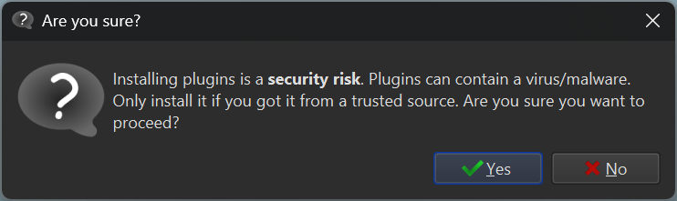
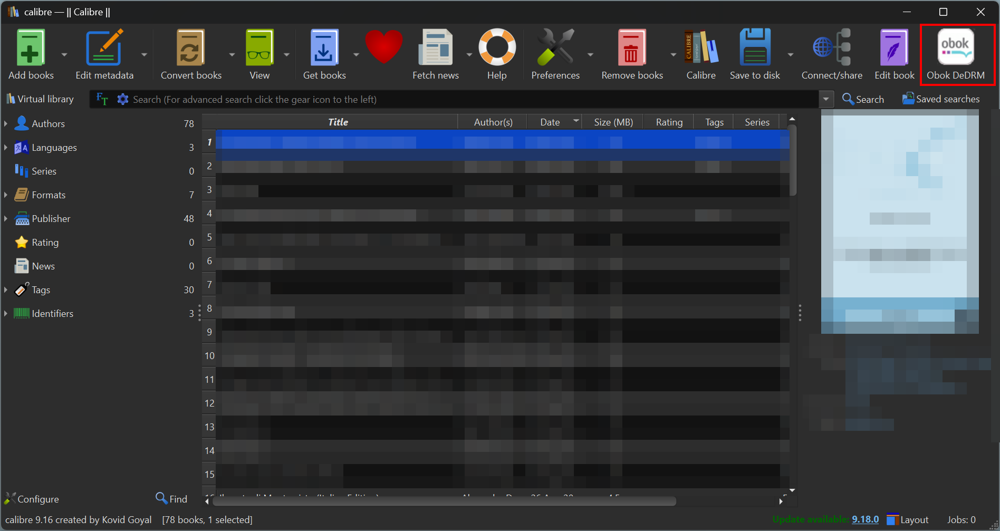
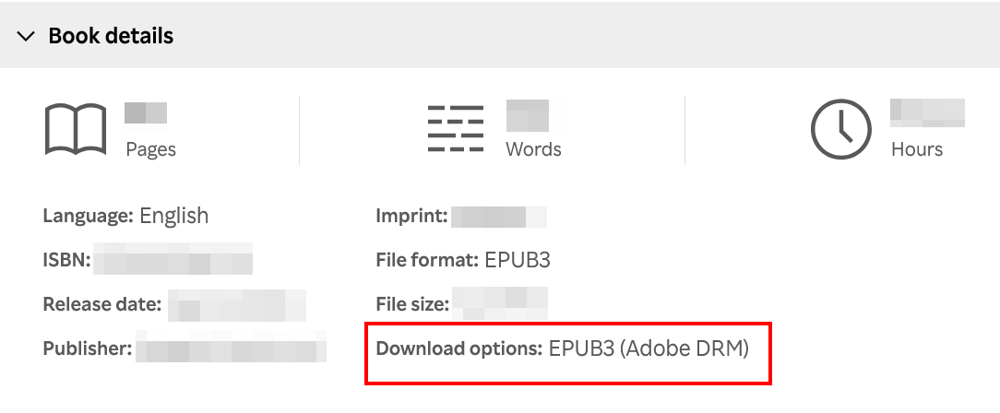

Here is a guide on how to remove the DRM from ebooks purchased on [Kobo](https://www.kobo.com/)[^naturally].

[^naturally]: Naturally, this blog post is just for educational purposes. Removing the DRM is a violation of Kobo's terms and conditions. This is a warning about the steps to avoid, so that they are not reproduced accidentally. I would never support the idea that buying an ebook online entitles you to owning it.

https://www.kobo.com/de/de/ebook/how-to-lie-with-statistics-3

## Adobe Digital Editions

Download and install [Adobe Digital Editions](https://www.adobe.com/content/cc/africa/en/solutions/ebook/digital-editions/download.html?allowfullpath=true) and install it.

Go to *Help > Authorize Computer*.
I recommend authorising the computer with login and password instead of proceeding without an ID.
Using an account ensures that other machines can be authorised for the same books[^ludicrous].
You can use a free [Adobe ID](https://account.adobe.com/).
Do not activate two factor authentication (2FA), otherwise the authorisation fails with no clear error message[^2fa].
You can activate the 2FA after the computer is authorised.

[^ludicrous]: Some people might consider ludicrous the idea of an account to read a book. I don't, I find it perfectly reasonable.

[^2fa]: I definitely didn't find this out by chance after [fighting with a useless chatbot to try to get the help of a human]().

## Calibre

Download and install [Calibre](https://calibre-ebook.com/download).
Download the [DeDRM_tools plugin by GitHub user *Satsuoni*](https://github.com/Satsuoni/DeDRM_tools)[^dedrm_version], which is a fork of the [version by GitHub user *noDRM*](https://github.com/noDRM), which is fork of [the original](https://github.com/apprenticeharper/DeDRM_tools) by [Apprentice Alf](https://apprenticealf.wordpress.com/).
Unzip the file, it should contain two other zip files *DeDRM_plugin.zip* and *Obok_plugin.zip*.
Keep those files zipped.

[^dedrm_version]: As of writing in November 2026, the most recent version is [v10.0.6s](https://github.com/Satsuoni/DeDRM_tools/releases/tag/v10.0.6s) released in July 2023.

Open Calibre.
Go to *Preferences > Plugins > Load Plugin from file*. 
Select one of the zip files of the plugin, then confirm.
Repeat for the second zip file.

Restart Calibre.
You should see a *Obok DeDrm* button on the menu.

## Kobo

Some books on Kobo are DRM free, but most of them use Adobe's DRM.
Kobo puts explicitly in the description whether the ebook is protected by DRM.

## Download the book from Kobo

## Remove the DRM

## Footnotes

