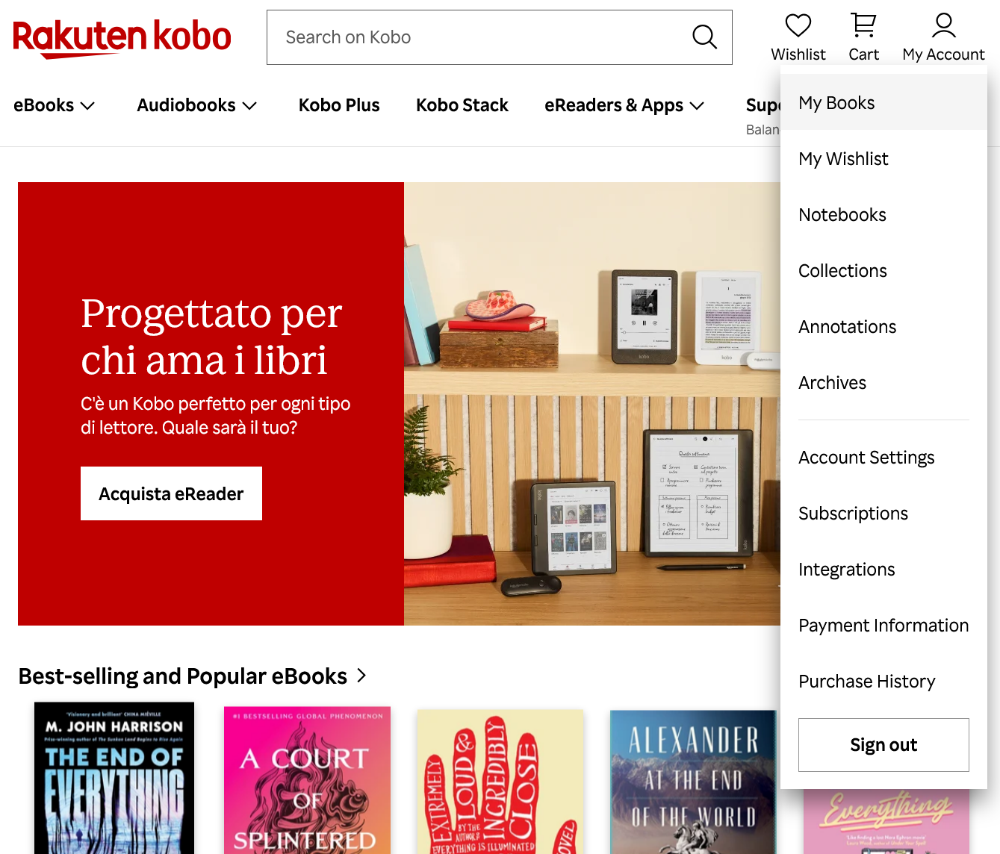
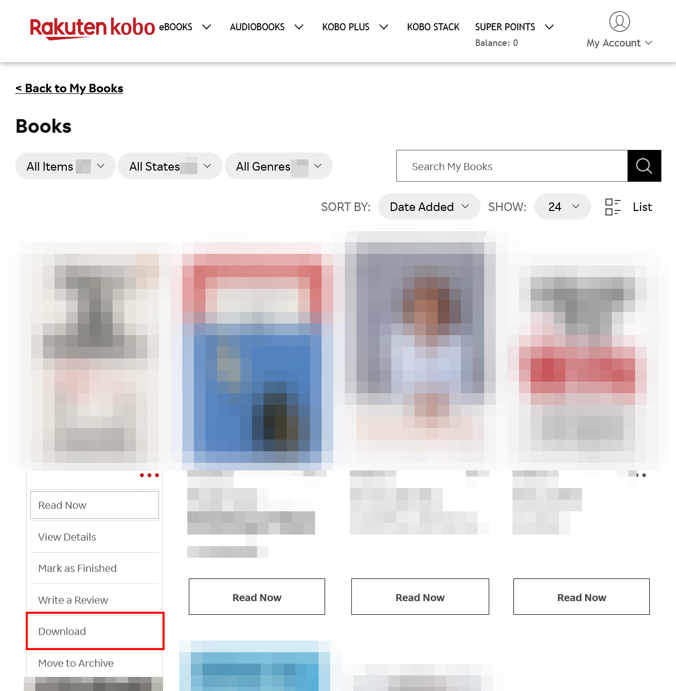
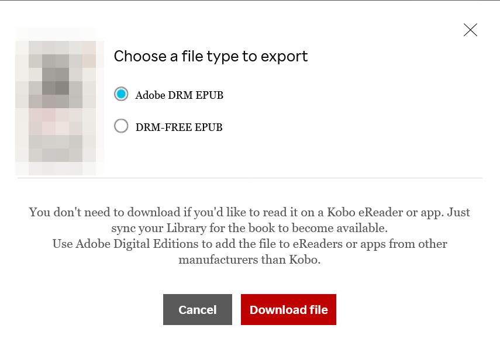
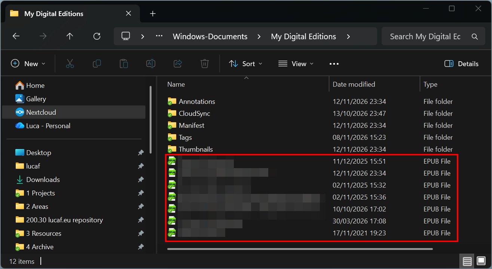
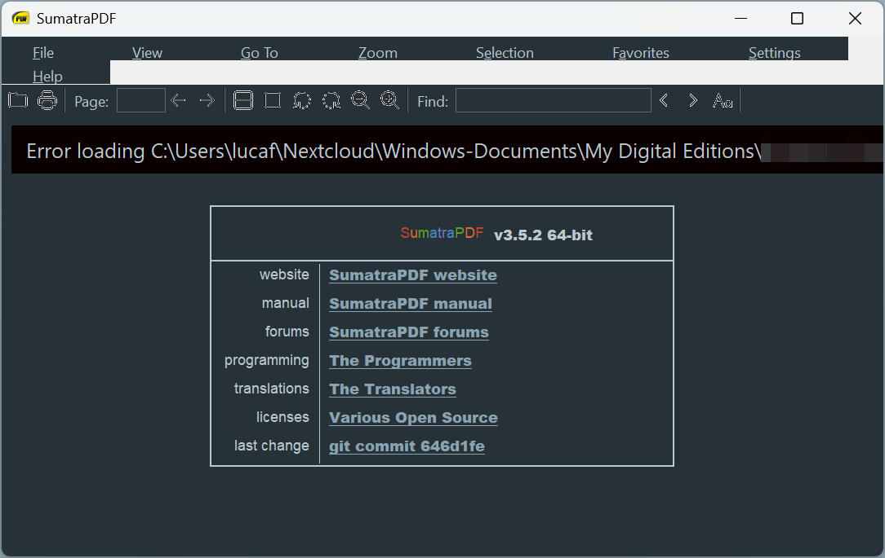
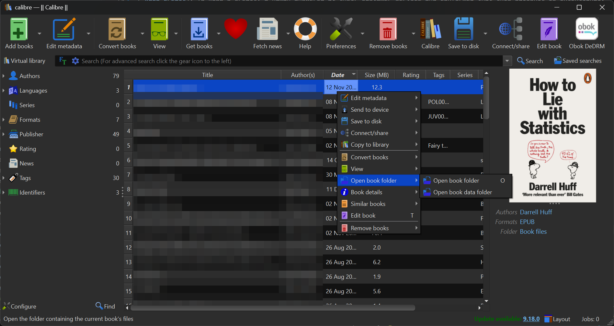
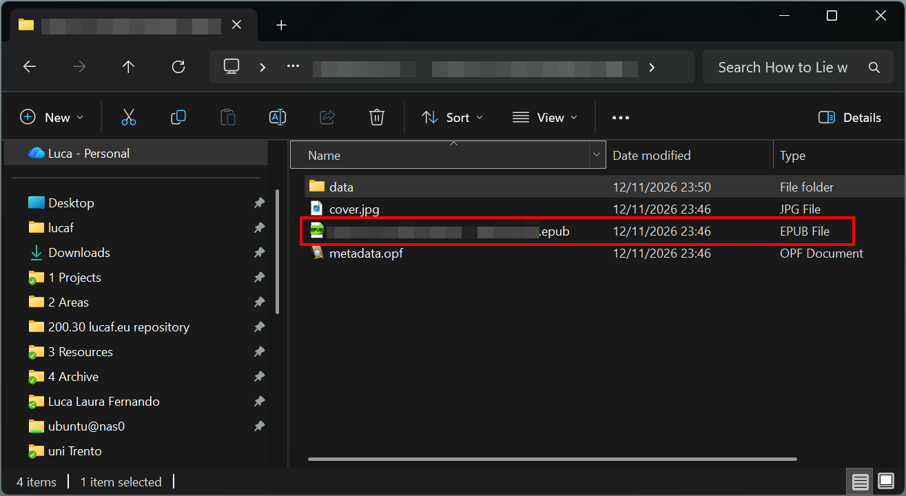

Here is a guide on how to remove the DRM from ebooks purchased on [Kobo](https://www.kobo.com/)[^naturally].

[^naturally]: Naturally, this blog post is for educational purposes only. Circumventing the DRM is a violation of Kobo's terms and conditions. I am warning about the steps to avoid, so that they are not reproduced accidentally. I would never support the idea that buying an ebook entitles you to owning it.

## Adobe Digital Editions

Download and install [Adobe Digital Editions](https://www.adobe.com/content/cc/africa/en/solutions/ebook/digital-editions/download.html?allowfullpath=true).
Go to *Help > Authorize Computer*.

I recommend authorising the computer with an account instead of proceeding without an ID.
With an account, other machines can be authorised for the same ebooks[^ludicrous].
You can use a free [Adobe ID](https://account.adobe.com/).
Do not activate the two factor authentication (2FA) on your account, otherwise the authorisation fails with no clear error message[^2fa].
You can (re-)activate the 2FA after the computer is authorised.

[^ludicrous]: Some people might consider ludicrous the idea of an account to read a book. I don't, I find it perfectly reasonable.

[^2fa]: I definitely didn't find this out on my own by chance after [fighting with a useless chatbot to try to get the help of a human]().

## Calibre

Download and install [Calibre](https://calibre-ebook.com/download).
Download the [DeDRM_tools plugin by GitHub user *Satsuoni*](https://github.com/Satsuoni/DeDRM_tools)[^dedrm_version], which is a fork of [this version by GitHub user *noDRM*](https://github.com/noDRM), which is fork of [the original](https://github.com/apprenticeharper/DeDRM_tools) by [Apprentice Alf](https://apprenticealf.wordpress.com/).
Unzip the file, it should contain two other zip files *DeDRM_plugin.zip* and *Obok_plugin.zip*.
Keep those files zipped.

[^dedrm_version]: As of writing in November 2026, the most recent version is [v10.0.6s](https://github.com/Satsuoni/DeDRM_tools/releases/tag/v10.0.6s) released in July 2023.

Open Calibre.
Go to *Preferences > Plugins > Load Plugin from file*. 
Select one of the zip files of the plugin and confirm.
Repeat for the second zip file.

  

  

  

Restart Calibre.
You should see an *Obok DeDrm* button on the menu.

## Kobo

Some books on Kobo are DRM free, but most of them use Adobe's DRM.
The book description on the store mentions whether the ebook is protected by DRM.

After purchasing the book, go to *My Account > My Books*.

Click the ellipsis under the book you want, then *Download*.

You are presented with two options: *Adobe DRM EPUB* and *DRM-FREE EPUB*.
The "DRM-free" option is a lie; it opens the book with Kobo's online reader with no download option[^kobo-credit].
Download the *Adobe DRM EPUB* option

[^kobo-credit]: To Kobo's credit, a human answered at their customer service and confirmed that this bullshit is intentional.

## Remove the DRM

You should have an acsm file from Kobo's website.
This is not yet the encrypted epub.
Open it with Adobe Digital Editions (the file extension should be associated automatically).
Digital Editions should download the book and show it in the library.

Go to the folder where Digital Editions' books are stored.
On Windows this is in *Documents > My Digital Editions*.
You should see all the encrypted epubs from your library.

As these files are encrypted, you will get an error if you try to open them with any other program, like [Sumatra PDF](https://www.sumatrapdfreader.org/free-pdf-reader).

Open Calibre, click on *Add books*, and select the encrypted epub from Digital Editions' folder.
You should now see the ebook in you Calibre Library.
Right click on the book, then *Open book folder > Open book folder*.

You should see Calibre's folder with a now unencrypted epub of your book.
You can open it on any device you want with any program you want[^disclaimer].

[^disclaimer]: Not that I would support such freedoms, as they are a violation of Kobo's terms and conditions. I obviously recommend reading Kobo's ebooks only on Kobo's devices or through Kobo's applications.

## Footnotes

