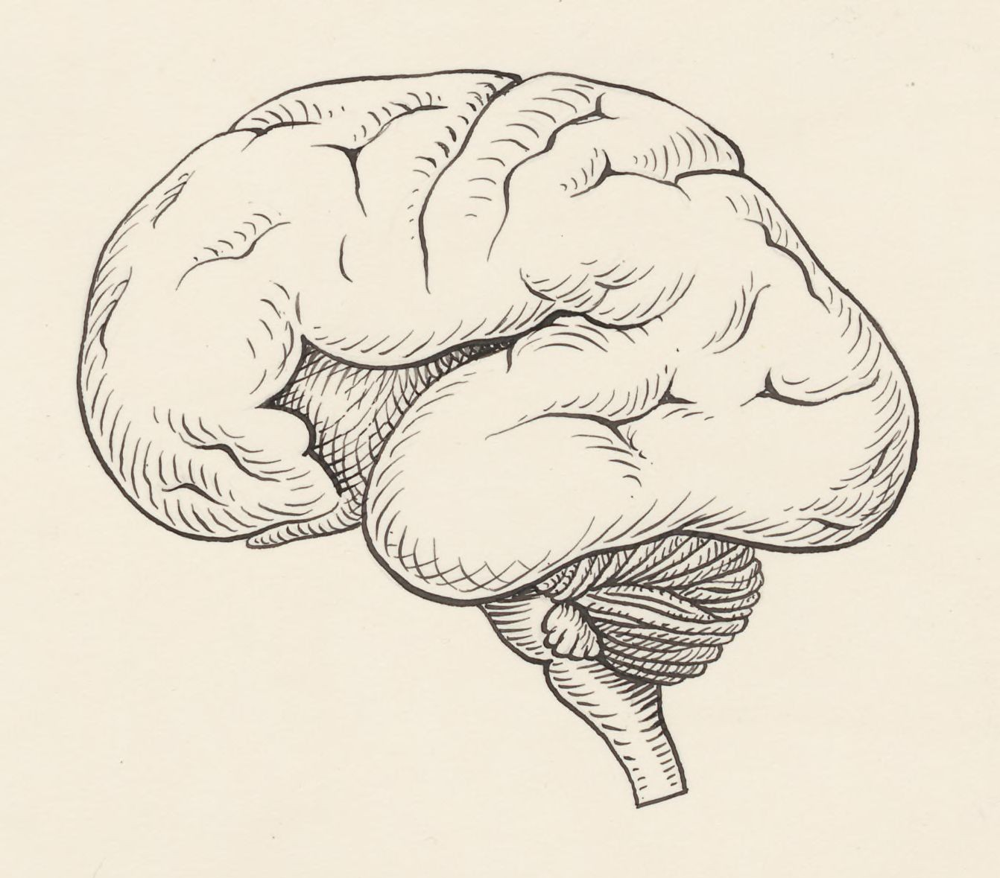

There is a pattern which I recognise in myself and others that annoys me.
It happens at work as well in my private life.
It is the tendency to act right away on new information without taking the time to think things through.
Not necessarily long deep thinking sessions, sometimes just 10 minutes can be enough.

{:refdef: style="text-align: center;"}
{: width="65%" }
{: refdef}
{:refdef: style="text-align: center;"}
*Drawing of a brain by J. Tinkelenberg, [item PK-ANAT-1795](https://catalogue.leidenuniv.nl/permalink/31UKB_LEU/1n0bhjp/alma9940131121602711) by Leiden University Libraries*
{: refdef}

Humans (including me) have brains that instinctively try to avoid thinking to save energy.
Acting without thinking feels good, even if it is counterproductive in the long run.

> We figured all this out a long time ago because we are clever humans who know how to think. Thinking is good, actually.
>
> [*Alec Watson of Technology Connections (YouTube)*](https://youtu.be/0KoeY54M5VA?si=D7kBi-pMmsy-xzH8&t=1114)

Thinking is a better option.
My best work was done when I took the time to think deeply about my objectives.
The work arising from serious thinking is also the kind I enjoy the most.

Not only is it good to think about things, but also meta-thinking about the thinking itself.
Why should we do a thing?
Is this the right thing to do?
Were it better if we did nothing at all?
What is this? Like, everything?
All this questions and more deserve thinking about them.
