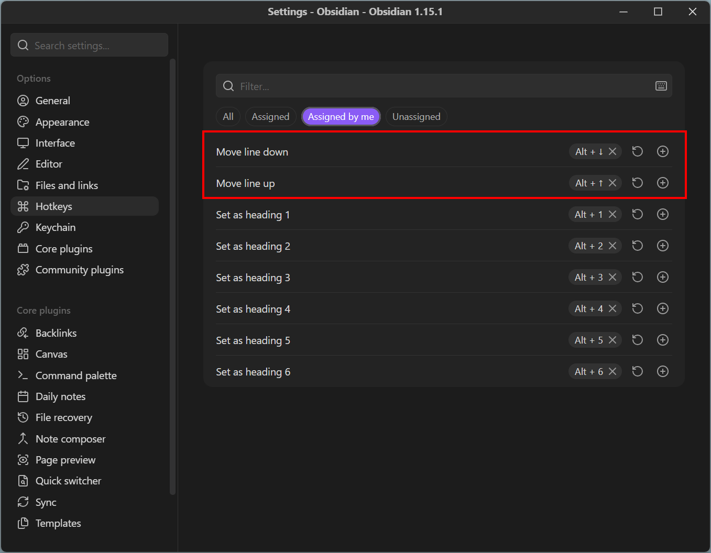

I maintain all of of my notes in Obsidian and write this blog in VS Code, so I like to keep similar shortcuts among the two applications.
I use Markdown for both.

Obsidian has the same as VS Code to delete the current line: `Ctrl+Shift+K`.
This is a [non-editable built-in shortcut](https://obsidian.md/help/editing-shortcuts#Text+editing).

Obsidian calls [hotkeys] the customisable shortcuts, which can be edited under *Settings > Hotkeys*.
I added to Obsidian the same shortcuts as VS Code to move lines up and down: `Alt+↓` and `Alt+↑`.

