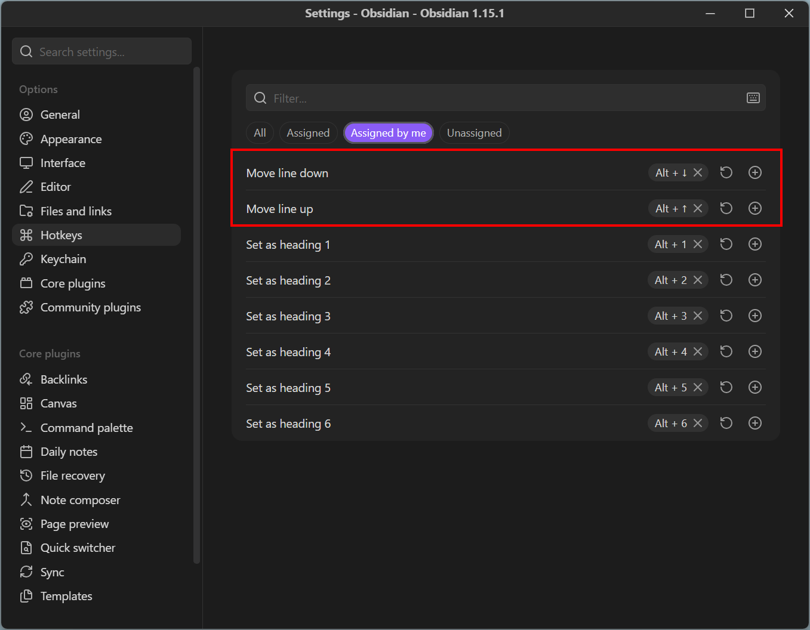

I write a lot of markdown: my notes in Obsidian and this blog in VS Code.

Conveniently, Obsidian has the same shortcut as VS Code to delete the current line: `Ctrl+Shift+K`.
This is a [non-editable shortcut](https://obsidian.md/help/editing-shortcuts#Text+editing), which is not visible in the settings.

Customisable shortcuts are called [hotkeys](https://obsidian.md/help/hotkeys) in Obsidian and can be edited under *Settings > Hotkeys*.
By default, Obsidian has no shortcut to move lines up and down.
I therefore added the same VS Code shortcuts (`Alt+↓` and `Alt+↑`) as Obsidian hotkeys.

