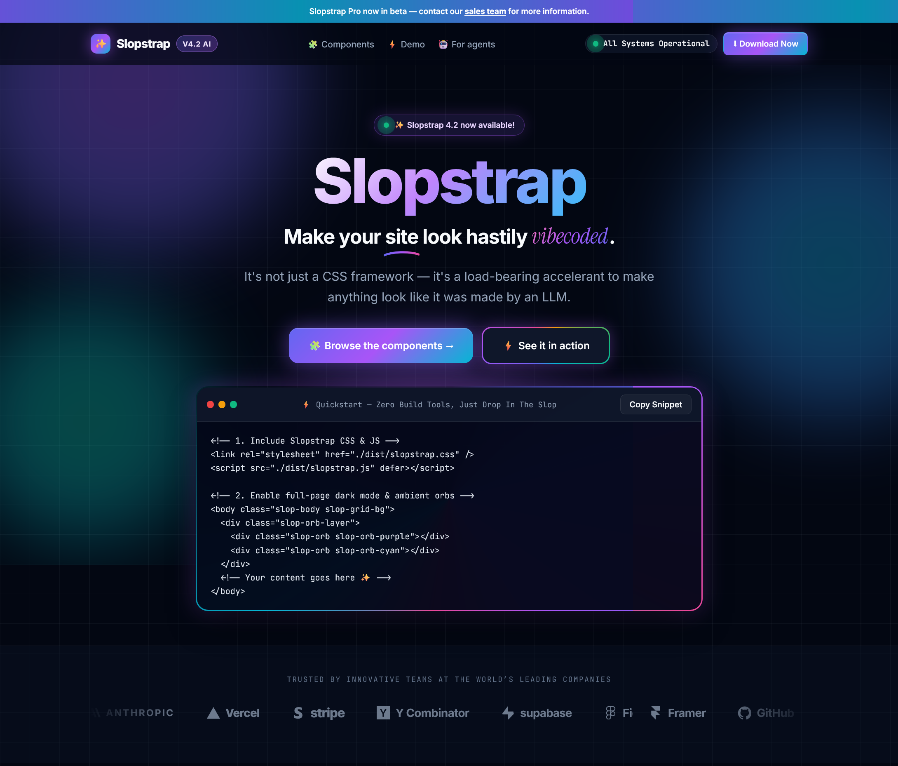

[Slopstrap](https://slopstrap.mikelacher.com/) is brilliant.
Human creativity to satirise human sloppiness in AI-assisted design.
[The code](https://slopstrap.mikelacher.com/dist/slopstrap.zip) is a piece of art too.

> > **It’s not just a CSS framework — it’s a complete paradigm shift in synthetic UI.**
> 
> **Slopstrap** is a zero-dependency, drop-in frontend library (like Bootstrap) purpose-built to make any website look unmistakably, unapologetically **vibecoded by an LLM in 3.4 seconds**.
> 
> Instead of carefully prompting an AI agent to reproduce the exact same dark-mode purple-gradient Tailwind landing page for the ten-millionth time, Slopstrap ships every certified AI design tell out of the box.

Archive copy: [website](/assets/2026/slopstrap/2026-11-23 Slopstrap — Make your site look hastily vibecoded.html) and [code](assets/2026/slopstrap/slopstrap-v4.2.0.zip).
